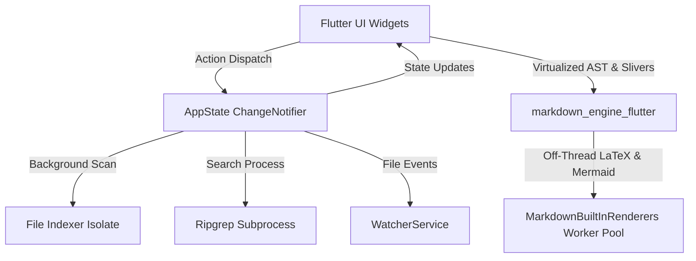

# Siren Architecture & Development

This document describes the architectural design and implementation patterns used in **Siren**.

---

## 1. High-Level Architecture

Siren is built using Flutter for macOS desktop. It employs a reactive unidirectional data flow centered around `AppState`, combined with `markdown_engine_flutter` virtualized sliver rendering and background Dart isolates to ensure the main UI thread remains responsive at 120 FPS.



---

## 2. Core Subsystems

### State Management (`lib/app_state.dart`)
- Centralized `AppState` extending `ChangeNotifier`.
- Manages open tabs, active document content, navigation history stacks, font sizes, themes, and search states.
- Persists critical UI state (recent files, sidebar visibility, theme, window bounds) to `SharedPreferences` and clears built-in renderer caches via `MarkdownBuiltInRenderers.clearCaches()`.

### Background Isolates & Processes
- **File Indexer (`lib/file_indexer.dart`)**: Traverses the workspace filesystem recursively inside a separate Dart isolate, filtering via include/exclude patterns and building an index of known Markdown documents.
- **Built-In Document & Mermaid Isolates (`markdown_engine_flutter`)**: Offloads large-document parsing (`MarkdownDocumentReader`) and vector Mermaid compilation (`MarkdownBuiltInRenderers.warmUp()` persistent worker pool using zero-copy `TransferableTypedData`) off the UI isolate cleanly.
- **Ripgrep Service (`lib/ripgrep_service.dart`)**: Spawns a background `rg` process with JSON output parsing for high-throughput global workspace searches.

### Search Services
- **Fuzzy Matcher (`lib/fuzzy_matcher.dart`)**: Multi-token fuzzy matching with word-boundary and camelCase prioritization.
- **Ripgrep Service (`lib/ripgrep_service.dart`)**: High-throughput global workspace search with clickable file and line jumps in both Raw and Rendered views (`MarkdownController.scrollToLine`).

### Live File Watching (`lib/watcher_service.dart`)
- Monitors file system modification and removal events.
- Employs debounce timers and delay strategies to handle macOS atomic saves (where editors write to a temporary file, delete the original, and rename).

### Virtualized Markdown, LaTeX, Mermaid & SVG Rendering (`markdown_engine_flutter`, `lib/rendered_view.dart`, `lib/siren_image_builder.dart`)
- `RenderedView` delegates parsing, sliver virtualization, GFM HTML conversion, GitHub alerts, YAML frontmatter cards, footnotes with inline `↩︎` back-links, OpenType `MATH` LaTeX (`tex_math_flutter` with `NewCMMath-Regular.otf`), and offline vector Mermaid diagrams (`pele_dart` + `vector_graphics`) to `MarkdownView` and `MarkdownController` from `markdown_engine_flutter` (`^0.2.1`).
- `OutlineView` (`lib/outline_view.dart`) extracts headings directly via `MarkdownEngine.parse().outline` and jumps through deduplicated heading slugs (`MarkdownController.scrollToAnchor`).
- `RenderedView` supplies `MarkdownBuilderDelegates` for `flutter_highlighter` fenced code blocks with copy buttons, Siren's permissive desktop `MarkdownUrlPolicy` (local relative files, `#anchor` links, `file://`, and `http`/`https`/`mailto`), `SirenImageBuilder` (`lib/siren_image_builder.dart`) for local/workspace relative path resolution, Shields.io/local SVG vector compilation, and `ImageZoomDialog` lightbox triggers, plus `onTapMermaid` opening `MermaidZoomDialog` (`lib/mermaid_zoom_dialog.dart`) for drag-to-pan zoom, 3x PNG clipboard copy, and `.svg`/`.png` export.
- `lib/main.dart` registers the `NewCMMath (tex_math_flutter)` GUST font license from `packages/tex_math_flutter/assets/fonts/GUST-FONT-LICENSE.txt` in Flutter's `LicenseRegistry` and pre-warms `MarkdownBuiltInRenderers.warmUp()`. `MainApp` sets `themeAnimationDuration: Duration.zero` and maps `SirenColors` into `MarkdownThemeData` so Light/Dark theme switching completes with zero re-parses.
- For the GitHub Pages Docsify portal (`docs/index.html`), `tool/generate_docs_math.dart` and `tool/generate_docs_diagrams.dart` pre-render Light and Dark SVGs across `docs/*.md` into `docs/tex_math_svgs.js` and `docs/pele_diagrams.js`.

---

## 3. Directory Structure

```text
siren/
├── assets/             # Bundled application assets (images, ripgrep binary)
├── docs/               # User and developer documentation
├── lib/                # Flutter Dart source code
│   ├── app_state.dart             # Core application state & recent items persistence
│   ├── editor_tabs.dart           # Workspace tab bar with drag-and-drop & context menus
│   ├── file_explorer.dart         # Directory tree view
│   ├── file_search_modal.dart     # Quick Open (Cmd+P) dialog
│   ├── find_in_file_bar.dart      # In-document search bar
│   ├── global_search_view.dart    # Workspace full-text search
│   ├── home_screen.dart           # Main window scaffold, menus & shortcuts
│   ├── image_zoom_dialog.dart     # Interactive image lightbox viewer
│   ├── mermaid_zoom_dialog.dart   # Interactive zoom, pan & export Mermaid modal
│   ├── outline_view.dart          # Heading hierarchy tree
│   ├── raw_view.dart              # Raw Markdown source view with line gutter
│   ├── rendered_view.dart         # Virtualized Markdown preview backed by markdown_engine_flutter
│   ├── siren_image_builder.dart   # Local/workspace image lookup, SVG badge compiler & lightbox hook
│   └── theme.dart                 # Light & dark theme extensions
├── macos/              # macOS native Runner project
└── test/               # Automated unit and widget test suite
```

---

## 4. Development & Testing

### Prerequisites
- Flutter SDK `^3.47.0` (Dart `^3.13.0`)
- macOS 12.0 or newer
- Xcode and Command Line Tools

### Setup and Running
```bash
# Clone the repository
git clone https://github.com/tkinnis/siren.git
cd siren

# Install dependencies
flutter pub get

# Run on macOS desktop
flutter run -d macos
```

### Running Tests
Siren includes extensive unit and widget tests covering Markdown parsing, tab management, fuzzy matching, line number alignment, and history navigation:

```bash
# Run all unit and widget tests
flutter test

# Run static analysis
flutter analyze
```
