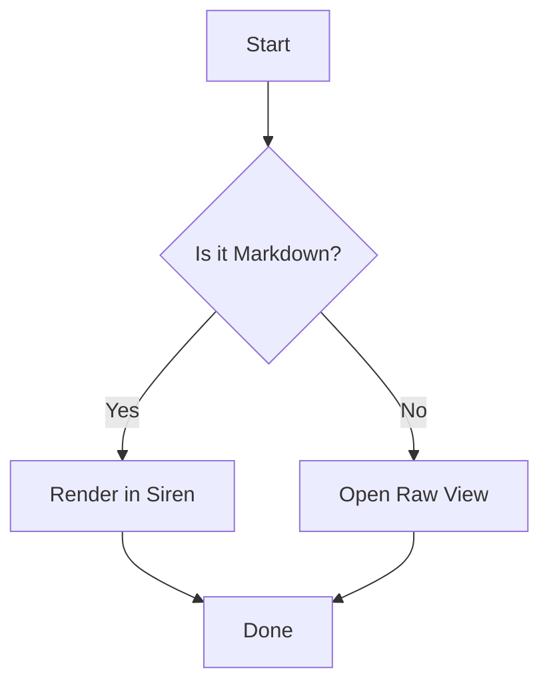
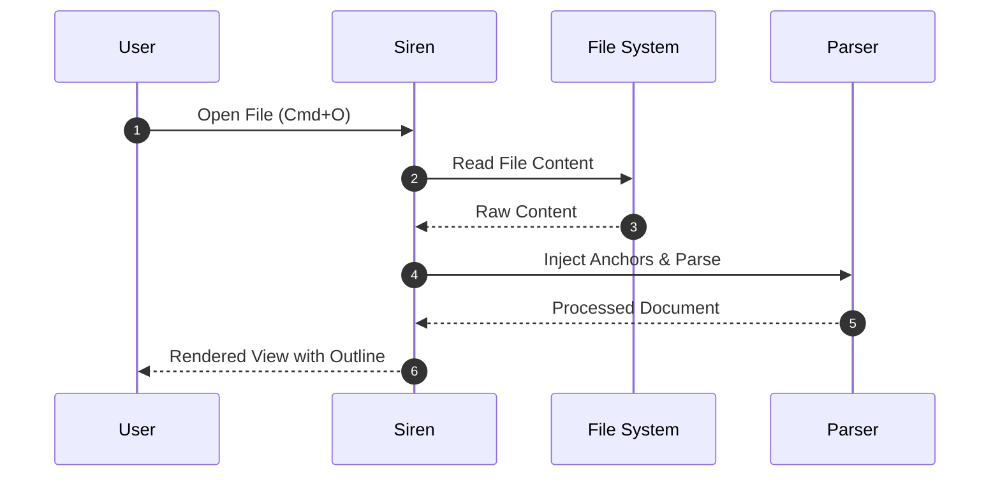

# Markdown Syntax Guide

This guide details all standard and extended Markdown syntax supported by **Siren**.

---

## 1. GitHub-Style Alerts

Siren supports GitHub-style blockquote alerts with dedicated icons, left borders, and contextual background styling:

### Note Alert
```markdown
> [!NOTE]
> Useful information that users should know, even when skimming.
```
> [!NOTE]
> Useful information that users should know, even when skimming.

### Tip Alert
```markdown
> [!TIP]
> Helpful advice or shortcuts for doing things faster or more easily.
```
> [!TIP]
> Helpful advice or shortcuts for doing things faster or more easily.

### Important Alert
```markdown
> [!IMPORTANT]
> Key information crucial for users to achieve their goal.
```
> [!IMPORTANT]
> Key information crucial for users to achieve their goal.

### Warning Alert
```markdown
> [!WARNING]
> Urgent info that needs immediate user attention to avoid problems.
```
> [!WARNING]
> Urgent info that needs immediate user attention to avoid problems.

### Caution Alert
```markdown
> [!CAUTION]
> Advises about risks or negative outcomes that could occur.
```
> [!CAUTION]
> Advises about risks or negative outcomes that could occur.

---

## 2. LaTeX Mathematics

Siren renders mathematical formulas using KaTeX.

### Inline Math
Enclose formulas in single dollar signs:
```markdown
Euler's formula states that $e^{i\pi} + 1 = 0$, and mass-energy equivalence is $E = mc^2$ where $c \approx 3 \times 10^8 \text{ m/s}$.
```
Euler's formula states that $e^{i\pi} + 1 = 0$, and mass-energy equivalence is $E = mc^2$ where $c \approx 3 \times 10^8 \text{ m/s}$.

### Display / Block Math
Enclose formulas in double dollar signs on their own lines:
```markdown
$$
\int_{-\infty}^{\infty} e^{-x^2} dx = \sqrt{\pi}
$$
```
$$
\int_{-\infty}^{\infty} e^{-x^2} dx = \sqrt{\pi}
$$

---

## 3. Mermaid Diagrams

Siren renders all 20 Mermaid v11 diagram categories offline using an offscreen vector compilation pipeline (`vector_graphics`) powered by the **ELK** layout engine (`layout: 'elk'`) and **`neo`** look with fenced code blocks labeled `mermaid`.

- **Proportional Scaling**: Increasing or decreasing the document font size via the `+` / `-` toolbar buttons (`Cmd+=` / `Cmd+-` / `Cmd+0`) scales Mermaid diagrams proportionally while remaining crisp at any resolution.
- **Interactive Zoom, Pan & Export Viewer**: Click any rendered diagram (or the hover **Zoom** button) to open it in a dedicated modal viewer supporting up to `1000%` magnification, drag-to-pan, trackpad pinch-to-zoom, Fit-to-Window, **Copy Diagram Image (PNG)** to the macOS clipboard, **Export Diagram (SVG / PNG)** to disk, and **Copy Mermaid Source**.
- **Comprehensive Examples**: Browse the **[Mermaid Diagram Examples Gallery](mermaid-examples.md)** for 52 examples across flowcharts, sequence, class, state, ER, user journey, Gantt, pie, quadrant, requirement, GitGraph, C4, mindmap, timeline, ZenUML, Sankey, XY chart, block, packet, kanban, architecture, and radar diagrams.

### Flowcharts


### Sequence Diagrams


---

## 4. YAML Frontmatter & Footnotes

### YAML Frontmatter
Documents starting on line 1 with a `---` YAML frontmatter block are automatically parsed and displayed as a structured **Frontmatter** metadata card at the top of Preview mode (as seen at the very top of this guide), with list/array entries rendered as pill badges. You can toggle frontmatter visibility at any time in **Settings (`Cmd+,` → Show YAML Frontmatter in Preview)**.

```markdown
---
title: Architecture Specification
author: Platform Team
status: Approved
tags: [macos, flutter, markdown]
---
```

### Footnotes
Siren supports GitHub Flavored Markdown footnotes using `[^id]` inline references and `[^id]: ...` definitions. Inline citations (`[1]`) are hyperlinked to jump directly to the GitHub-style separated footnotes section at the bottom of the page, and each footnote's `↩︎` return link jumps back to its citation:

```markdown
Siren compiles Mermaid diagrams into native vector bytecode[^1] and supports named references[^note].

[^1]: Powered by `vector_graphics_compiler` and offline ELK layout.
[^note]: Footnote definitions are collected and numbered at the bottom of the rendered document.
```

Siren compiles Mermaid diagrams into native vector bytecode[^1] and supports named references[^note].

[^1]: Powered by `vector_graphics_compiler` and offline ELK layout.
[^note]: Footnote definitions are collected and numbered at the bottom of the rendered document.

---

## 5. Text Formatting & Extensions

### Highlighting
Wrap text in double equals signs to highlight:
```markdown
==Highlighted text== for emphasizing critical terms.
```
==Highlighted text== for emphasizing critical terms.

### Subscript & Superscript
- Subscript (chemical formulas): `H~2~O, C~6~H~12~O~6~` produces H~2~O, C~6~H~12~O~6~
- Superscript (exponents): `E = mc^2^, 2^10^ = 1024` produces E = mc^2^, 2^10^ = 1024
- Combined notation: `X^2^~i~` produces X^2^~i~

### CommonMark Line Breaks
In accordance with the CommonMark specification:
- **Soft Line Break**: A single newline in a paragraph joins words with a space.
- **Hard Line Break**: End a line with two spaces or a backslash `\` to create an explicit line break.

---

## 6. Standard Markdown

### Typography
- **Bold text** with asterisks or underscores (`**Bold text**`).
- *Italic text* for emphasis (`*Italic text*`).
- ***Bold and italic combined*** (`***Bold and italic combined***`).
- ~~Strikethrough~~ for deprecated content (`~~Strikethrough~~`).
- `Inline code snippet` for functions and identifiers.

### Headings
```markdown
# Heading 1 (Document Title)
## Heading 2 (Major Section)
### Heading 3 (Subsection)
#### Heading 4
##### Heading 5
###### Heading 6
```

### Lists
#### Unordered Lists
```markdown
- Bullet point item
- Another item
  - Indented sub-item
```
- Bullet point item
- Another item
  - Indented sub-item

#### Ordered Lists
```markdown
1. First step
2. Second step
   1. Sub-step A
   2. Sub-step B
```
1. First step
2. Second step
   1. Sub-step A
   2. Sub-step B

#### Task Lists
```markdown
- [x] Initial design review
- [x] Implement outline view
- [ ] Write integration test
```
- [x] Initial design review
- [x] Implement outline view
- [ ] Write integration test

### Tables
```markdown
| Command | Shortcut | Description |
| :--- | :---: | :--- |
| Quick Open | `Cmd+P` | Fuzzy search files |
| Find in File | `Cmd+F` | Search current document |
| Global Search | `Cmd+Shift+F` | Full-text search across workspace |
```

| Command | Shortcut | Description |
| :--- | :---: | :--- |
| Quick Open | `Cmd+P` | Fuzzy search files |
| Find in File | `Cmd+F` | Search current document |
| Global Search | `Cmd+Shift+F` | Full-text search across workspace |

### Code Blocks
Fenced code blocks support syntax highlighting with language identifiers and a one-click **Copy** button:

```dart
void main() {
  final app = SirenApp();
  app.run();
}
```

### Images & Click-to-Zoom Lightbox
Local and network Markdown images (``) render inline and can be clicked to open in an interactive **Image Viewer** lightbox with pan and zoom controls (click the image below to try it):

```markdown

```


### Relative Document Links
Relative Markdown links automatically open target documents in Siren:
```markdown
Check out the [Features Guide](features.md) or [Keyboard Shortcuts](shortcuts.md).
```
Check out the [Features Guide](features.md) or [Keyboard Shortcuts](shortcuts.md).

If the target document is already open in a tab, Siren switches directly to that tab.

---

## 7. Embedded HTML (GFM)

Siren natively parses and renders the full GitHub Flavored Markdown HTML tag set used in project `README.md` files and technical specifications.

### Keyboard Keycaps (`<kbd>`)
Render native keycap badges with `<kbd>`:
```html
Press <kbd>Cmd</kbd> + <kbd>P</kbd> for Quick Open, or <kbd>Cmd</kbd> + <kbd>Shift</kbd> + <kbd>F</kbd> for Workspace Search.
```
Press <kbd>Cmd</kbd> + <kbd>P</kbd> for Quick Open, or <kbd>Cmd</kbd> + <kbd>Shift</kbd> + <kbd>F</kbd> for Workspace Search.

### Inline HTML Typography (`<sub>`, `<sup>`, `<mark>`, `<u>`, `<del>`, `<abbr>`, `<small>`, `<q>`, `<samp>`, `<var>`, `<br>`)
```html
Water is H<sub>2</sub>O, $2^{10}$ is 2<sup>10</sup> = 1024, <mark>highlighted terms</mark>, <u>underlined text</u>, <del>deprecated text</del>, <abbr title="GitHub Flavored Markdown">GFM</abbr>, <small>fine print</small>, <q>quoted text</q>, <samp>output</samp>, and <var>x</var>.
```
Water is H<sub>2</sub>O, $2^{10}$ is 2<sup>10</sup> = 1024, <mark>highlighted terms</mark>, <u>underlined text</u>, <del>deprecated text</del>, <abbr title="GitHub Flavored Markdown">GFM</abbr>, <small>fine print</small>, <q>quoted text</q>, <samp>output</samp>, and <var>x</var>.

Use `<br>` inside Markdown table cells for multi-line entries:

| Area | Shortcuts |
| :--- | :--- |
| **Navigation** | <kbd>Cmd</kbd> + <kbd>[</kbd> Back<br><kbd>Cmd</kbd> + <kbd>]</kbd> Forward |
| **View Modes** | <kbd>Cmd</kbd> + <kbd>E</kbd> Toggle Preview / Raw<br><kbd>Cmd</kbd> + <kbd>B</kbd> Toggle Sidebar |

### Centered Blocks, Sized ``, SVG Badges, `<picture>` Theme Switching & `<a>` Links
Align hero sections and size images using `<p align="center">`, `<div align="center">`, `<h1 align="center">`, ``, `<picture><source media="(prefers-color-scheme: dark)" ...>`, `<a href="...">`, and SVG badges (automatically detected via HTTP `Content-Type` / payload inspection and rendered at `3x` Retina resolution):

```html
<a href="https://flutter.dev/">
  <h1 align="center">
    <picture>
      <source media="(prefers-color-scheme: dark)" srcset="https://docs.flutter.dev/logo_dark.png">
      
    </picture>
  </h1>
</a>

<p align="center">
  
</p>

<p align="center">
  <strong>Centered HTML block with sized local assets, SVG badges, and clickable links.</strong>
</p>

<p align="center">
  
  
  
</p>
```

<a href="https://flutter.dev/">
  <h1 align="center">
    <picture>
      <source media="(prefers-color-scheme: dark)" srcset="https://docs.flutter.dev/logo_dark.png">
      
    </picture>
  </h1>
</a>

<p align="center">
  
</p>

<p align="center">
  <strong>Centered HTML block with sized local assets, SVG badges, and clickable links.</strong>
</p>

<p align="center">
  
  
  
</p>

### HTML Tables (`<table>`), Lists (`<ul>`, `<ol>`), and Description Lists (`<dl>`)
Raw HTML tables (`<table>`, `<thead>`, `<tbody>`, `<tr>`, `<th>`, `<td>`, `<caption>`) and description lists (`<dl>`, `<dt>`, `<dd>`) render natively alongside Markdown content:

```html
<table>
  <tr>
    <th>Element</th>
    <th align="center">Category</th>
    <th>Example</th>
  </tr>
  <tr>
    <td><code>&lt;kbd&gt;</code></td>
    <td align="center">Inline</td>
    <td><kbd>Cmd</kbd> + <kbd>P</kbd></td>
  </tr>
  <tr>
    <td><code>&lt;details&gt;</code></td>
    <td align="center">Block</td>
    <td>Collapsible disclosure card</td>
  </tr>
</table>

<dl>
  <dt>Single-Tab Invariant</dt>
  <dd>Opening an already-open document focuses its existing tab instead of duplicating it.</dd>
  <dt>Offscreen Vector Engine</dt>
  <dd>Compiles Mermaid v11 diagrams and SVG badges at Retina resolution without blocking the UI isolate.</dd>
</dl>
```

<table>
  <tr>
    <th>Element</th>
    <th align="center">Category</th>
    <th>Example</th>
  </tr>
  <tr>
    <td><code>&lt;kbd&gt;</code></td>
    <td align="center">Inline</td>
    <td><kbd>Cmd</kbd> + <kbd>P</kbd></td>
  </tr>
  <tr>
    <td><code>&lt;details&gt;</code></td>
    <td align="center">Block</td>
    <td>Collapsible disclosure card</td>
  </tr>
</table>

<dl>
  <dt>Single-Tab Invariant</dt>
  <dd>Opening an already-open document focuses its existing tab instead of duplicating it.</dd>
  <dt>Offscreen Vector Engine</dt>
  <dd>Compiles Mermaid v11 diagrams and SVG badges at Retina resolution without blocking the UI isolate.</dd>
</dl>

### Collapsible Disclosure Sections (`<details>` & `<summary>`)
Create interactive expandable sections using `<details>` and `<summary>` (add `open` to start expanded):

```html
<details open>
  <summary>Expanded by Default (Click to Toggle)</summary>

  Nested **Markdown**, `inline code`, and lists render inside `<details>`:
  - Supports `open` attribute
  - Renders nested Markdown blocks
</details>

<details>
  <summary>Collapsed Troubleshooting Notes</summary>

  Use `<details>` blocks to keep long logs or secondary notes tidy until needed.
</details>
```

<details open>
  <summary>Expanded by Default (Click to Toggle)</summary>

  Nested **Markdown**, `inline code`, and lists render inside `<details>`:
  - Supports `open` attribute
  - Renders nested Markdown blocks
</details>

<details>
  <summary>Collapsed Troubleshooting Notes</summary>

  Use `<details>` blocks to keep long logs or secondary notes tidy until needed.
</details>

### HTML Comments (`<!-- ... -->`)
HTML comments (`<!-- hidden note -->`) are automatically stripped in Rendered Preview while remaining visible in **Raw View** (<kbd>Cmd</kbd> + <kbd>E</kbd>) and inside fenced/inline code blocks.
<!-- This HTML comment is hidden in Rendered View but visible in Raw View -->
