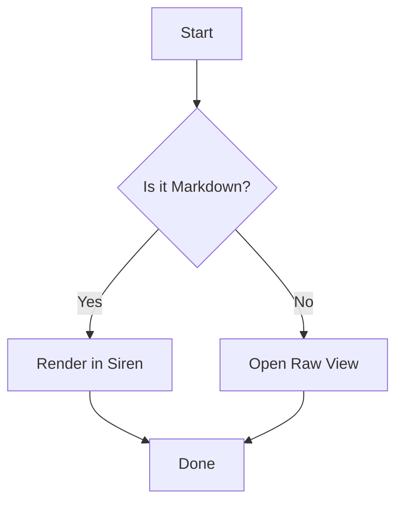
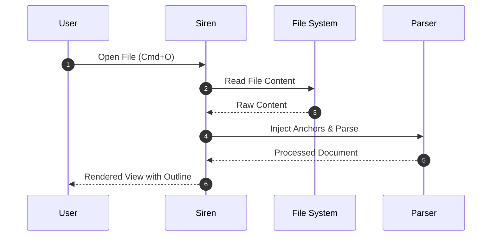
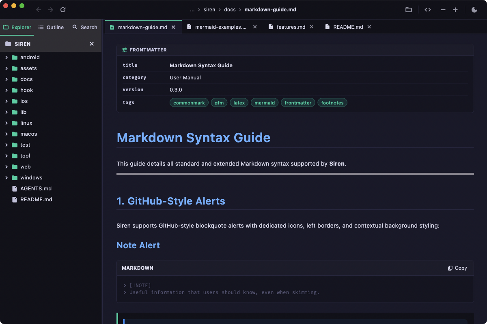

# Markdown Syntax Guide

This guide details all standard and extended Markdown syntax supported by **Siren**.

---

## 1. GitHub-Style Alerts

Siren supports GitHub-style blockquote alerts with dedicated icons, left borders, and contextual background styling:

### Note Alert
```markdown
> [!NOTE]
> Useful information that users should know, even when skimming.
```
> [!NOTE]
> Useful information that users should know, even when skimming.

### Tip Alert
```markdown
> [!TIP]
> Helpful advice or shortcuts for doing things faster or more easily.
```
> [!TIP]
> Helpful advice or shortcuts for doing things faster or more easily.

### Important Alert
```markdown
> [!IMPORTANT]
> Key information crucial for users to achieve their goal.
```
> [!IMPORTANT]
> Key information crucial for users to achieve their goal.

### Warning Alert
```markdown
> [!WARNING]
> Urgent info that needs immediate user attention to avoid problems.
```
> [!WARNING]
> Urgent info that needs immediate user attention to avoid problems.

### Caution Alert
```markdown
> [!CAUTION]
> Advises about risks or negative outcomes that could occur.
```
> [!CAUTION]
> Advises about risks or negative outcomes that could occur.

---

## 2. LaTeX Mathematics

Siren renders mathematical formulas using KaTeX.

### Inline Math
Enclose formulas in single dollar signs:
```markdown
Euler's formula states that $e^{i\pi} + 1 = 0$.
```
Euler's formula states that $e^{i\pi} + 1 = 0$.

### Display / Block Math
Enclose formulas in double dollar signs on their own lines:
```markdown
$$
\int_{-\infty}^{\infty} e^{-x^2} dx = \sqrt{\pi}
$$
```
$$
\int_{-\infty}^{\infty} e^{-x^2} dx = \sqrt{\pi}
$$

---

## 3. Mermaid Diagrams

Siren renders all 20 Mermaid v11 diagram categories offline using an offscreen vector compilation pipeline (`vector_graphics`) powered by the **ELK** layout engine (`layout: 'elk'`) and **`neo`** look with fenced code blocks labeled `mermaid`.

- **Proportional Scaling**: Increasing or decreasing the document font size via the `+` / `-` toolbar buttons (`Cmd+=` / `Cmd+-` / `Cmd+0`) scales Mermaid diagrams proportionally while remaining crisp at any resolution.
- **Interactive Zoom, Pan & Export Viewer**: Click any rendered diagram (or the hover **Zoom** button) to open it in a dedicated modal viewer supporting up to `1000%` magnification, drag-to-pan, trackpad pinch-to-zoom, Fit-to-Window, **Copy Diagram Image (PNG)** to the macOS clipboard, **Export Diagram (SVG / PNG)** to disk, and **Copy Mermaid Source**.
- **Comprehensive Examples**: Browse the **[Mermaid Diagram Examples Gallery](mermaid-examples.md)** for 52 examples across flowcharts, sequence, class, state, ER, user journey, Gantt, pie, quadrant, requirement, GitGraph, C4, mindmap, timeline, ZenUML, Sankey, XY chart, block, packet, kanban, architecture, and radar diagrams.

### Flowcharts


### Sequence Diagrams


---

## 4. YAML Frontmatter & Footnotes

### YAML Frontmatter
Documents starting with a `---` YAML frontmatter block are automatically parsed and displayed as a structured **Frontmatter** metadata card in Preview mode (also visible at the very top of this guide):

```markdown
---
title: Architecture Specification
author: Platform Team
status: Approved
tags: [macos, flutter, markdown]
---
```

---
title: Architecture Specification
author: Platform Team
status: Approved
tags: [macos, flutter, markdown]
---

### Footnotes
Siren supports GitHub Flavored Markdown footnotes using `[^id]` inline references and `[^id]: ...` definitions:

```markdown
Siren compiles Mermaid diagrams into native vector bytecode[^1] and supports named references[^note].

[^1]: Powered by `vector_graphics_compiler` and offline ELK layout.
[^note]: Footnote definitions are collected and numbered at the bottom of the rendered document.
```

Siren compiles Mermaid diagrams into native vector bytecode[^1] and supports named references[^note].

[^1]: Powered by `vector_graphics_compiler` and offline ELK layout.
[^note]: Footnote definitions are collected and numbered at the bottom of the rendered document.

---

## 5. Text Formatting & Extensions

### Highlighting
Wrap text in double equals signs to highlight:
```markdown
==Highlighted text== for emphasizing critical terms.
```
==Highlighted text== for emphasizing critical terms.

### Subscript & Superscript
- Subscript: `H~2~O` produces H~2~O
- Superscript: `E = mc^2^` produces E = mc^2^
- Combined: `X^2^~i~` produces X^2^~i~

### CommonMark Line Breaks
In accordance with the CommonMark specification:
- **Soft Line Break**: A single newline in a paragraph joins words with a space.
- **Hard Line Break**: End a line with two spaces or a backslash `\` to create an explicit line break.

---

## 6. Standard Markdown

### Headings
```markdown
# Heading 1 (Document Title)
## Heading 2 (Major Section)
### Heading 3 (Subsection)
#### Heading 4
##### Heading 5
###### Heading 6
```

### Lists
#### Unordered Lists
```markdown
- Bullet point item
- Another item
  - Indented sub-item
```
- Bullet point item
- Another item
  - Indented sub-item

#### Ordered Lists
```markdown
1. First step
2. Second step
   1. Sub-step A
   2. Sub-step B
```
1. First step
2. Second step
   1. Sub-step A
   2. Sub-step B

#### Task Lists
```markdown
- [x] Initial design review
- [x] Implement outline view
- [ ] Write integration test
```
- [x] Initial design review
- [x] Implement outline view
- [ ] Write integration test

### Tables
```markdown
| Command | Shortcut | Description |
| :--- | :---: | :--- |
| Quick Open | `Cmd+P` | Fuzzy search files |
| Find in File | `Cmd+F` | Search current document |
| Global Search | `Cmd+Shift+F` | Full-text search across workspace |
```

| Command | Shortcut | Description |
| :--- | :---: | :--- |
| Quick Open | `Cmd+P` | Fuzzy search files |
| Find in File | `Cmd+F` | Search current document |
| Global Search | `Cmd+Shift+F` | Full-text search across workspace |

### Code Blocks
Fenced code blocks support syntax highlighting with language identifiers and a one-click **Copy** button:

```dart
void main() {
  final app = SirenApp();
  app.run();
}
```

### Images & Click-to-Zoom Lightbox
Local and network Markdown images (``) render inline and can be clicked to open in an interactive **Image Viewer** lightbox with pan and zoom controls (click the image below to try it):

```markdown

```


### Relative Document Links
Relative Markdown links automatically open target documents in Siren:
```markdown
Check out the [Features Guide](features.md) or [Keyboard Shortcuts](shortcuts.md).
```
Check out the [Features Guide](features.md) or [Keyboard Shortcuts](shortcuts.md).

If the target document is already open in a tab, Siren switches directly to that tab.
