# Mermaid Diagram Examples

A comprehensive gallery of Mermaid diagrams demonstrating all diagram types supported in **Siren**: flowcharts, sequence diagrams, state diagrams, class diagrams, entity-relationship diagrams, Gantt charts, pie charts, Git graphs, user journeys, requirement diagrams, XY charts, quadrant charts, mindmaps, timelines, Sankey diagrams, packet diagrams, block diagrams, Kanban boards, C4 context diagrams, and architecture diagrams.

---

## 1. Flowcharts & Graphs

### Simple Left-Right Graph

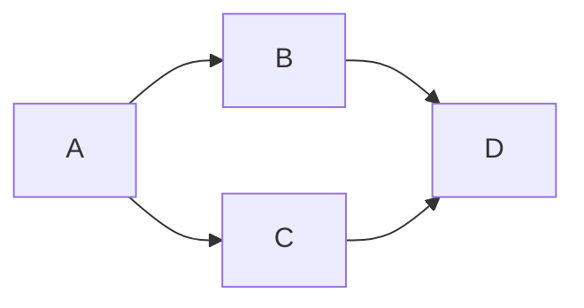

### Simple Top-Down Graph

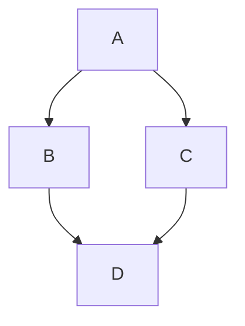

### Sequential Chapter Flow

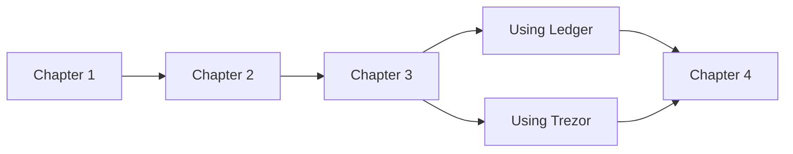

### Dependency Sets

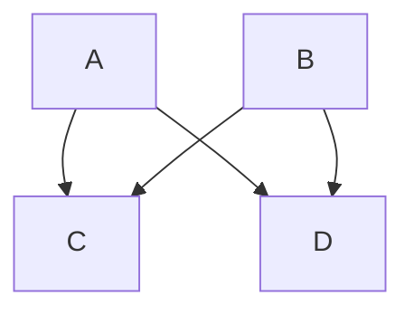

### Binary Tree

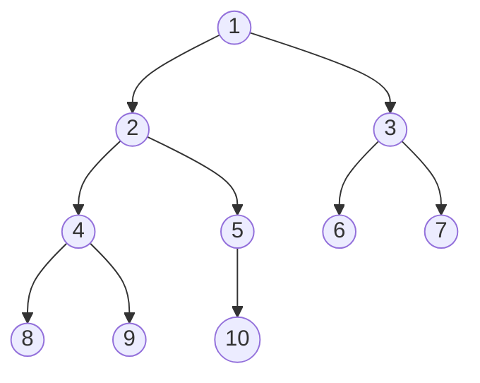

### Node Shapes & Link Variants

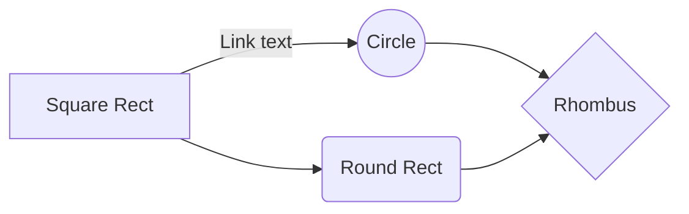

### Basic Decision Flowchart

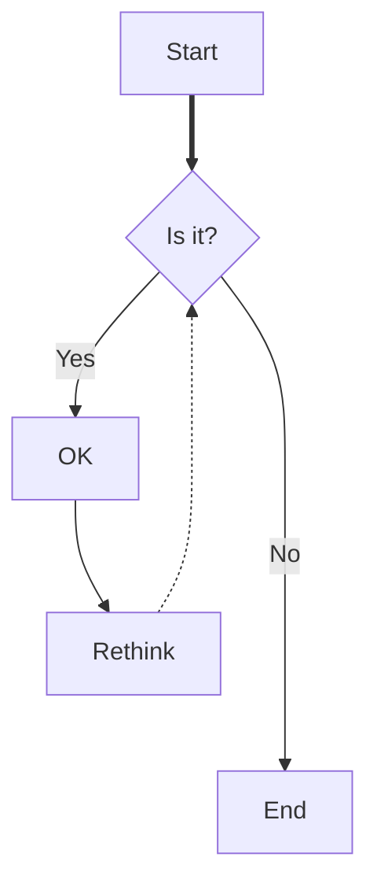

### Troubleshooting Flowchart

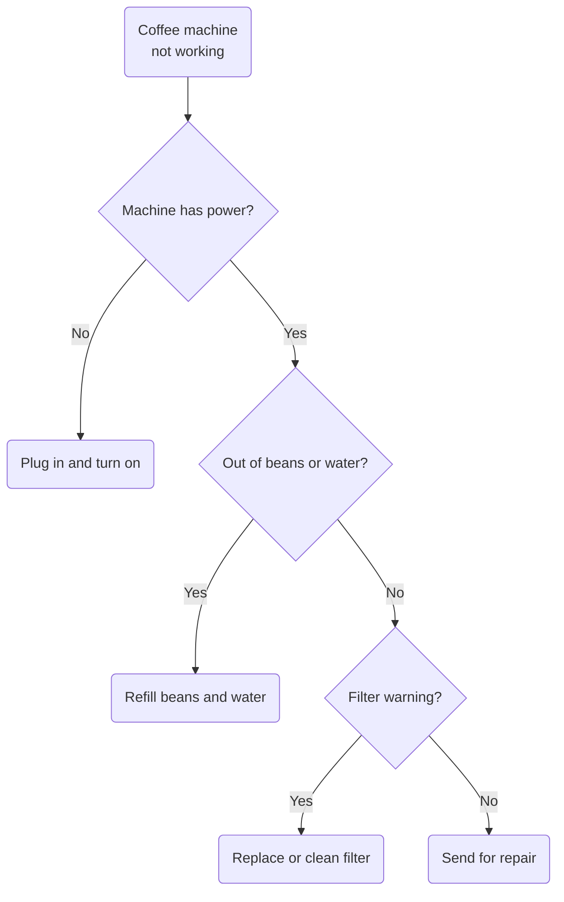

### Flowchart with Hyperlinks

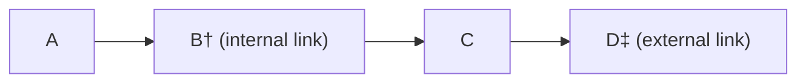

### Multi-Class Styled Flowchart

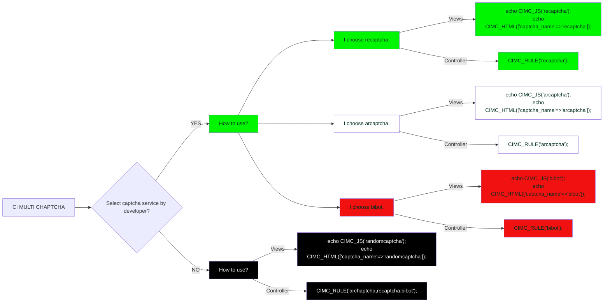

### Subgraphs

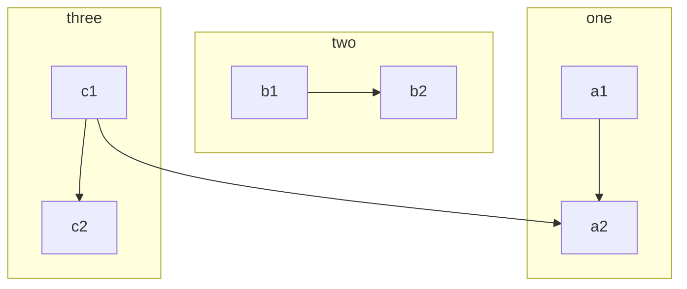

### Themed Subgraph

```mermaid
graph LR
    subgraph 1[System Flow]
        CP([Command Palette])
        subgraph 2[Black Box]
            QA(Quick Addition)
            QM(Macro)
        end
        B[Call Script]
        C[Open URI]
        D[Load Workspace]
        CP --> QA --> QM --> B --> C --> D
    end
style 1 fill:#333333,stroke:#FFFFFF,stroke-width:2px
style 2 fill:#222222,stroke:#FFFFFF,stroke-width:1px
```

### Larger Flowchart with Custom Styling

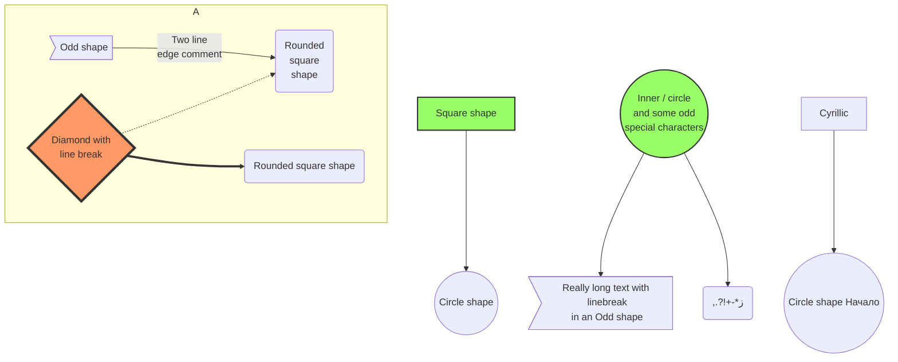

### Decision Tree

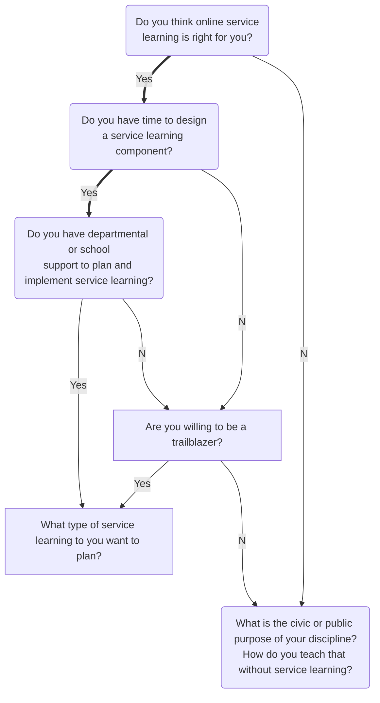

### Styled Links

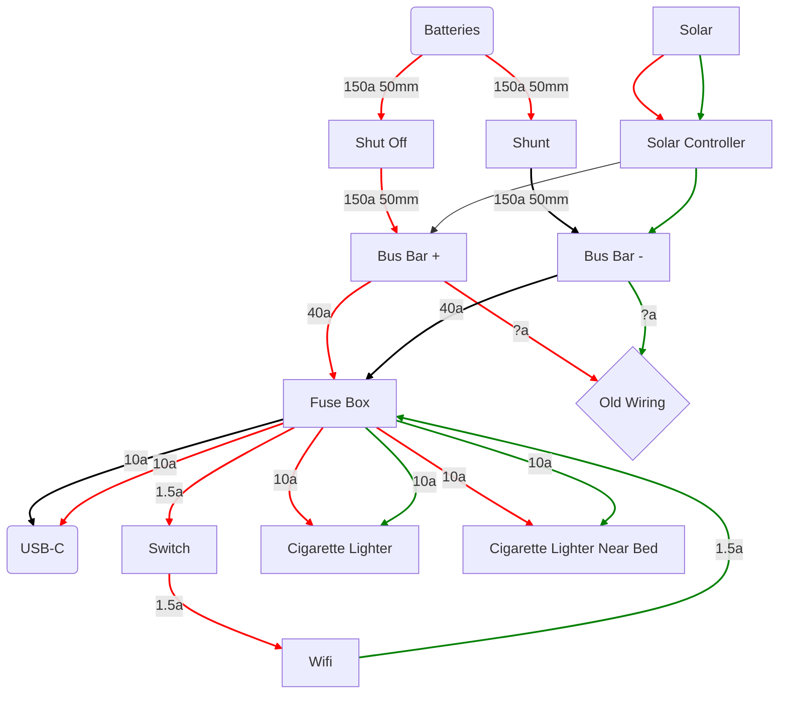

### Styled Flowchart with Subgraph Title

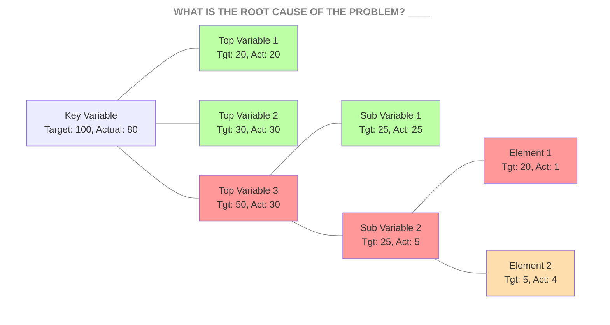

---

## 2. Sequence Diagrams

### Basic Sequence Diagram

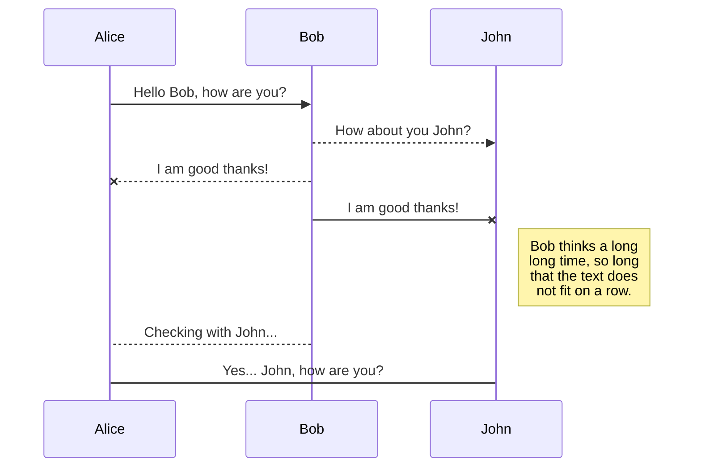

### Three-Way Handshake

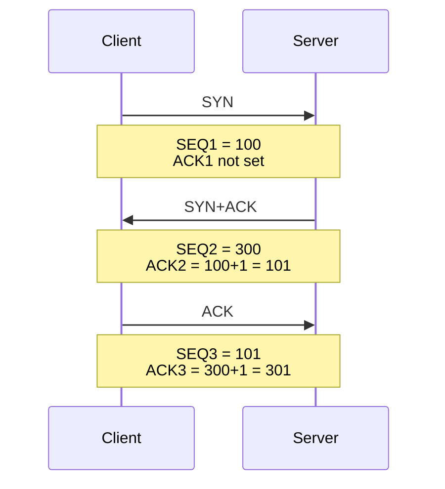

### Query Forwarding Sequence

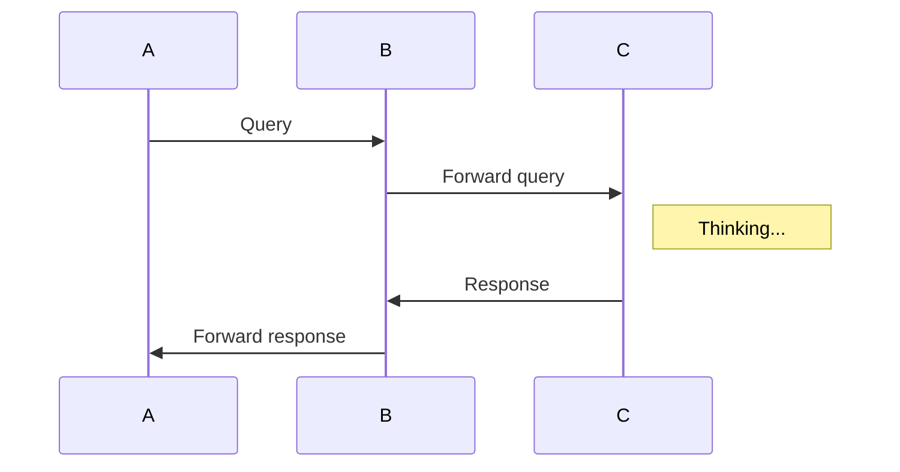

### Iframe Render Lifecycle

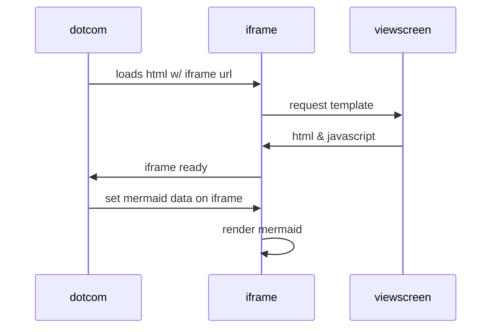

### Autonumbered Sequence with Loop & Notes

```mermaid
sequenceDiagram
    autonumber
    Student->>Admin: Can I enrol this semester?
    loop enrolmentCheck
        Admin->>Admin: Check previous results
    end
    Note right of Admin: Exam results may <br> be delayed
    Admin-->>Student: Enrolment success
    Admin->>Professor: Assign student to tutor
    Professor-->>Admin: Student is assigned
```

### Loops, Alt, and Opt Blocks

```mermaid
sequenceDiagram
    loop Daily query
        Alice->>Bob: Hello Bob, how are you?
        alt is sick
            Bob->>Alice: Not so good :(
        else is well
            Bob->>Alice: Feeling fresh like a daisy
        end

        opt Extra response
            Bob->>Alice: Thanks for asking
        end
    end
```

### Message to Self in Loop

```mermaid
sequenceDiagram
    participant Alice
    participant Bob
    Alice->>John: Hello John, how are you?
    loop HealthCheck
        John->>John: Fight against hypochondria
    end
    Note right of John: Rational thoughts<br/>prevail...
    John-->>Alice: Great!
    John->>Bob: How about you?
    Bob-->>John: Jolly good!
```

### Blogging App Service Communication

```mermaid
sequenceDiagram
    participant web as Web Browser
    participant blog as Blog Service
    participant account as Account Service
    participant mail as Mail Service
    participant db as Storage

    Note over web,db: The user must be logged in to submit blog posts
    web->>+account: Logs in using credentials
    account->>db: Query stored accounts
    db->>account: Respond with query result

    alt Credentials not found
        account->>web: Invalid credentials
    else Credentials found
        account->>-web: Successfully logged in

        Note over web,db: When the user is authenticated, they can now submit new posts
        web->>+blog: Submit new post
        blog->>db: Store post data

        par Notifications
            blog--)mail: Send mail to blog subscribers
            blog--)db: Store in-site notifications
        and Response
            blog-->>-web: Successfully posted
        end
    end
```

---

## 3. State Diagrams

### Simple State Diagram

```mermaid
stateDiagram-v2
    [*] --> Still
    Still --> [*]
    Still --> Moving
    Moving --> Still
    Moving --> Crash
    Crash --> [*]
```

### Document Lifecycle State Diagram

```mermaid
stateDiagram-v2
  [*] --> Unwritten

  Unwritten --> Open: Open
  Unwritten --> Void: Void

  Open --> Void: Void
  Open --> Cancelled: Cancel
  Open --> Closed: Close
  Open --> Open: Update

  Closed --> Open: Open
```

### Composite State

```mermaid
stateDiagram-v2
    [*] --> First
    state First {
        [*] --> second
        second --> [*]
    }
```

### Fork and Join State Diagram

```mermaid
stateDiagram-v2
    state fork_state <<fork>>
      [*] --> fork_state
      fork_state --> State2
      fork_state --> State3

      state join_state <<join>>
      State2 --> join_state
      State3 --> join_state
      join_state --> State4
      State4 --> [*]
```

### State Diagram with Notes

```mermaid
stateDiagram-v2
    State1: The state with a note
    note right of State1
        Important information! You can write
        notes.
    end note
    State1 --> State2
    note left of State2 : This is the note to the left.
```

### Shipment Status State Diagram

```mermaid
stateDiagram-v2
  direction LR
  [*] --> Initialed
  Initialed --> SellerSent
  SellerSent --> Transported
  Transported --> BuyerPicked
  BuyerPicked --> Delivered
  Delivered --> [*]

  BuyerPicked --> BuyerSent
  BuyerSent --> ReturnTransported
  ReturnTransported --> SellerPicked
  SellerPicked --> [*]

  Transported --> ReturnTransported: buyer doesn't pick up the item after 1 week
```

---

## 4. Class Diagrams

### Inheritance and Methods

```mermaid
classDiagram
    Animal <|-- Duck
    Animal <|-- Fish
    Animal <|-- Zebra
    Animal : +int age
    Animal : +String gender
    Animal: +isMammal()
    Animal: +mate()
    class Duck{
      +String beakColor
      +swim()
      +quack()
    }
    class Fish{
      -int sizeInFeet
      -canEat()
    }
    class Zebra{
      +bool is_wild
      +run()
    }
```

---

## 5. Entity Relationship Diagrams

### Customer Orders Schema

```mermaid
erDiagram
    CUSTOMER ||--o{ ORDER : places
    CUSTOMER {
        string name
        string custNumber
        string sector
    }
    ORDER ||--|{ LINE-ITEM : contains
    ORDER {
        int orderNumber
        string deliveryAddress
    }
    LINE-ITEM {
        string productCode
        int quantity
        float pricePerUnit
    }
```

### E-Commerce Domain Relationships

```mermaid
erDiagram
    CUSTOMER }|..|{ DELIVERY-ADDRESS : has
    CUSTOMER ||--o{ ORDER : places
    CUSTOMER ||--o{ INVOICE : "liable for"
    DELIVERY-ADDRESS ||--o{ ORDER : receives
    INVOICE ||--|{ ORDER : covers
    ORDER ||--|{ ORDER-ITEM : includes
    PRODUCT-CATEGORY ||--|{ PRODUCT : contains
    PRODUCT ||--o{ ORDER-ITEM : "ordered in"
```

---

## 6. Gantt Charts

### Multi-Team Project Schedule

```mermaid
gantt
    title Example Gantt diagram
    dateFormat YYYY-MM-DD
    section Team 1
    Research & requirements :done, a1, 2020-03-08, 2020-04-10
    Review & documentation  :after a1, 20d
    section Team 2
    Implementation          :crit, active, 2020-03-25, 20d
    Testing                 :crit, 20d
```

### Sequential Tasks with Excluded Date

```mermaid
gantt
    dateFormat YYYY-MM-DD
    title Adding GANTT diagram to mermaid
    excludes 2014-01-10

    section A section
    Completed task :done, des1, 2014-01-06, 2014-01-08
    Active task    :active, des2, 2014-01-09, 3d
    Future task    :des3, after des2, 5d
    Future task2   :des4, after des3, 5d
```

---

## 7. Pie Charts

### Streaming Time Breakdown

```mermaid
pie title NETFLIX
    "Time spent looking for movie" : 90
    "Time spent watching it" : 10
```

### Character Attributes Breakdown

```mermaid
pie title What Voldemort doesn't have?
    "FRIENDS" : 2
    "FAMILY" : 3
    "NOSE" : 45
```

### Volunteer Pet Adoptions

```mermaid
pie title Pets adopted by volunteers
    "Dogs" : 386
    "Cats" : 85
    "Rats" : 15
```

---

## 8. Git Graphs (`gitGraph`)

### Commit, Tag, and Branch Flow

```mermaid
gitGraph
    commit id: "Ashish"
    branch newbranch
    checkout newbranch
    commit id: "1111"
    commit tag: "test"
    checkout main
    commit type: HIGHLIGHT
    commit
    merge newbranch
    commit
    branch b2
    commit
```

### Custom Node Spacing & Branch Merge

```mermaid
%%{init: { 'gitGraph': {'nodeSpacing': 150, 'nodeRadius': 10, 'mainBranchName': 'master'} } }%%
gitGraph
    commit
    branch newbranch
    checkout newbranch
    commit
    commit
    checkout master
    commit
    commit
    merge newbranch
```

---

## 9. User Journey Diagrams

### Working Day Journey

```mermaid
journey
    title My working day
    section Go to work
      Make tea: 5: Me
      Go upstairs: 3: Me
      Do work: 1: Me, Cat
    section Go home
      Go downstairs: 5: Me
      Sit down: 3: Me
```

---

## 10. Requirement Diagrams

### Requirement Satisfaction

```mermaid
requirementDiagram

    requirement test_req {
    id: 1
    text: the test text.
    risk: high
    verifymethod: test
    }

    element test_entity {
    type: simulation
    }

    test_entity - satisfies -> test_req
```

---

## 11. XY Charts (`xychart-beta`)

### Quarterly Sales Revenue

```mermaid
xychart-beta
    title "Quarterly Sales Revenue"
    x-axis [Q1, Q2, Q3, Q4]
    y-axis "Revenue (in $k)" 0 --> 120
    bar [45, 72, 88, 110]
    line [40, 68, 85, 105]
```

---

## 12. Quadrant Charts (`quadrantChart`)

### Campaign Reach vs. Engagement

```mermaid
quadrantChart
    title Reach and engagement of campaigns
    x-axis Low Reach --> High Reach
    y-axis Low Engagement --> High Engagement
    quadrant-1 We should expand
    quadrant-2 Need to promote
    quadrant-3 Re-evaluate
    quadrant-4 May be improved
    Campaign A: [0.3, 0.6]
    Campaign B: [0.45, 0.23]
    Campaign C: [0.57, 0.69]
    Campaign D: [0.78, 0.34]
    Campaign E: [0.40, 0.34]
    Campaign F: [0.35, 0.78]
```

---

## 13. Mindmaps (`mindmap`)

### Feature Hierarchy Mindmap

```mermaid
%%{init: {'layout': 'cose-bilkent'}}%%
mindmap
  root((Siren))
    Rendering
      CommonMark
      GitHub Alerts
      LaTeX Math
      Mermaid ELK
    Navigation
      Quick Open
      Outline View
      File Explorer
    Search
      Ripgrep Engine
      Regex Indexing
```

---

## 14. Timelines (`timeline`)

### Chronological Platform History

```mermaid
timeline
    title History of Social Media Platform
    2002 : LinkedIn
    2004 : Facebook
         : Google
    2005 : YouTube
    2006 : Twitter
```

---

## 15. Sankey Diagrams (`sankey-beta`)

### Bio-Conversion Energy Flow

```mermaid
sankey-beta

Agricultural 'waste',Bio-conversion,124.729
Bio-conversion,Liquid,0.597
Bio-conversion,Losses,26.862
Bio-conversion,Solid,280.322
Bio-conversion,Gas,81.144
```

---

## 16. Packet Diagrams (`packet-beta`)

### TCP Packet Header

```mermaid
packet-beta
0-15: "Source Port"
16-31: "Destination Port"
32-63: "Sequence Number"
64-95: "Acknowledgment Number"
96-99: "Data Offset"
100-105: "Reserved"
106: "URG"
107: "ACK"
108: "PSH"
109: "RST"
110: "SYN"
111: "FIN"
112-127: "Window"
128-143: "Checksum"
144-159: "Urgent Pointer"
```

---

## 17. Block Diagrams (`block-beta`)

### Layered Database Block Diagram

```mermaid
block-beta
columns 1
  db(("DB"))
  blockArrowId6<["   "]>(down)
  block:ID
    A
    B["A wide one in the middle"]
    C
  end
  space
  D
  ID --> D
  C --> D
  style B fill:#969,stroke:#333,stroke-width:4px
```

---

## 18. Kanban Boards (`kanban`)

### Project Workflow Board

```mermaid
kanban
  Todo
    [Design Mermaid Gallery]
  In Progress
    [Verify ELK + Neo Layout]
  Done
    [Bundle Offline Assets]
    [Proportional Font Scaling]
```

---

## 19. C4 Architecture Diagrams (`C4Context`)

### System Context Diagram

```mermaid
C4Context
    title System Context diagram for Internet Banking System
    Person(customerA, "Banking Customer A", "A customer of the bank.")
    System(SystemAA, "Internet Banking System", "Allows customers to view information about their bank accounts, and make payments.")
    System_Ext(SystemE, "Mainframe Banking System", "Stores all of the core banking information about customers, accounts, transactions, etc.")
    Rel(customerA, SystemAA, "Uses")
    Rel(SystemAA, SystemE, "Uses")
```

---

## 20. Architecture Diagrams (`architecture-beta`)

### Cloud Service Topology

```mermaid
architecture-beta
    group api(cloud)[API]

    service db(database)[Database] in api
    service disk1(disk)[Storage] in api
    service server(server)[Server] in api

    db:L -- R:server
    disk1:T -- B:server
```
